<!-- Banner alternativo (rojo con sombra larga): cambia banner-dots.svg por banner-red.svg -->

  

  
  

### `$ whoami`

  

Ingeniero en Sistemas Computacionales enfocado en **IA aplicada a procesos de negocio**. Diseño prompts e instrucciones para modelos de lenguaje, **skills de Claude**, **agentes con tool use** y **servidores MCP** que automatizan trabajo contable y financiero con reglas verificables y supervisión humana.

Vengo de más de 3 años como **Consultor Funcional ERP / GRP** en el sector público. Eso me permite unir el conocimiento del negocio con la IA generativa y convertir reglas de negocio en instrucciones precisas y herramientas que el usuario final sí puede operar.

### `$ cat proyectos/reciente.md`

**Migración contable asistida por IA** — 2026

- **Prompt engineering y skill de Claude:** reglas contables y presupuestales traducidas a instrucciones estructuradas.
- **Agente con tool use y servidor MCP propio:** consulta catálogos y documentos de contexto (RAG) y propone alternativas con evidencia.
- **Aplicación de carga automatizada**, construida con Claude Code y Playwright: ejecuta el proceso en el sistema con sesiones en paralelo, trazabilidad, reportes y reanudación sin duplicados.
- **Humano en el ciclo:** lo que la IA no debe decidir se convierte en preguntas para el usuario sin detener el trabajo masivo.
- **Enfoque ágil:** entregas incrementales, backlog priorizado y validación continua con los usuarios.

| Área | Herramientas |
|---|---|
| **IA** | Claude Code · Claude API (tool use) · MCP (servidor propio) · Skills de Claude · RAG |
| **Backend** | Python 3.13 · FastAPI · Uvicorn · Pydantic · Playwright (Chromium) · SQLite · openpyxl · pypdf |
| **Frontend** | JavaScript (ES modules) · HTML · CSS |
| **Calidad** | pytest (237 pruebas automatizadas) · pip-audit |
| **Metodología** | Agile · Scrum · backlog e historias de usuario |

### `$ ls ~/stack`

  
  
  
  
  
  
  
  
  
   
  
  
  
  
  
  
  
  
  
   
  
  
  
  
  
  
   
  
  
  
  
  

### `$ ls ~/certificaciones/ia`

| Curso / certificación | Emisor | Fecha |
|---|---|---|
| Claude with Amazon Bedrock | Anthropic | ago&nbsp;2026 |
| Claude Code 101 | Anthropic | may&nbsp;2026 |
| Claude 101 | Anthropic | may&nbsp;2026 |
| Introduction to Claude Cowork | Anthropic | may&nbsp;2026 |
| AI Fluency: Framework & Foundations | Anthropic | may&nbsp;2026 |
| AWS AI Fundamentals | AWS / TIDWIT | ago&nbsp;2026 |
| IA sin Límites (8.5 h) | AWS / TIDWIT | ago&nbsp;2026 |
| Domina la IA con Gemini · Herramientas de IA de Google | Google Gemini / Nex·ia | jul&nbsp;2026 |
| Prompting Responsable: Maximiza la IA en tu Negocio | Santander Open Academy | may&nbsp;2026 |

<b>Proyectos, liderazgo, nube y redes</b>

 

| Curso / certificación | Emisor | Fecha |
|---|---|---|
| Máster en Project Management (en curso) | OBS Business School · Universitat de Barcelona | 2026&nbsp;–&nbsp;2027 |
| Gestión de Proyectos y Fundamentos de Metodología Agile · Liderazgo | Santander Open Academy | may&nbsp;2026 |
| Hablar en Público con Técnicas Teatrales | Santander Open Academy / Escuela TAI | ago&nbsp;2026 |
| Fundamentos de Nube AWS | AWS / TIDWIT | 2024 |
| CCNAv7 | Cisco Networking Academy | 2023&nbsp;–&nbsp;2024 |
| NDG Linux Essentials | Cisco Networking Academy | 2023 |
| Formación complementaria en ciberseguridad (Maltego) | Fundación Telefónica | — |

### `$ cat /var/log/actividad`

<!-- Estas dos imágenes las genera sola la GitHub Action (.github/workflows/perfil.yml) una vez al día. -->

  

  <picture>
    <source media="(prefers-color-scheme: dark)" srcset="https://raw.githubusercontent.com/Froyo89/Froyo89/output/snake-dark.svg" />
    <source media="(prefers-color-scheme: light)" srcset="https://raw.githubusercontent.com/Froyo89/Froyo89/output/snake-light.svg" />
    
  </picture>

### `$ ping contacto`

  
  

<code>// el mejor prompt es el que entiende el negocio</code>

